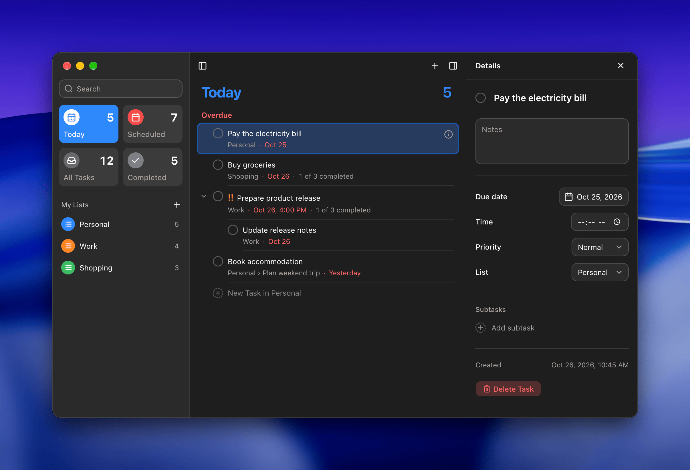

# Reminders

Reminders is a desktop to-do app that keeps your tasks in color-coded lists, with nested subtasks,
due dates, priorities, and smart lists for what is due today and what is scheduled.



- **Smart lists**: Today, Scheduled, All, and Completed, each showing how many tasks it holds.
- **Lists**: your own lists, each with a name and a color.
- **Subtasks**: nest tasks under other tasks, indent and outdent them, and move them up and down
  without breaking a task away from its parent.
- **Details**: notes, a due date and time, and a priority for every task.
- **Sorting**: by hand, due date, creation date, title, or priority, with completed tasks shown or
  hidden for each list.
- **Search**: finds tasks and subtasks by title and notes, and shows which list each result is in.
- **Undo**: deleting a task with subtasks asks first, and Undo brings the whole task back.
- **Keyboard and menus**: create, complete, nest, and reschedule tasks from the keyboard or the
  Task menu.
- **Settings**: light, dark, or system theme, launch at login, and showing the window at startup.

## Download

Get the latest version from the
[Releases page](https://github.com/mo-browser-apps/reminders/releases/latest) and download the file
for your computer:

| Platform | File |
| --- | --- |
| macOS (Apple Silicon) | `Reminders-<version>-arm64.dmg` |
| macOS (Intel) | `Reminders-<version>-x64.dmg` |
| Windows | the `.exe` installer |
| Linux | `Reminders-<version>-linux-x64.tar.gz`: extract it and run the `Reminders` executable inside |

The `.nupkg` and `releases.*.json` files on the release page are used for app updates. You don't
need to download them.

## Requirements

To run the app from source or build it, you need:

- macOS 14 (Apple Silicon) or later, Windows 10 (64-bit) or later, or Ubuntu 22.04 (64-bit) or
  later.
- [Node.js](https://nodejs.org/en/download) 24.14.1 (LTS) or later.

## Running from source

```bash
git clone https://github.com/mo-browser-apps/reminders.git
cd reminders
npm install
npm run dev
```

To run the end-to-end tests:

```bash
npm run test:e2e
```

## Building

To build the app for the platform you're on:

```bash
npm run build
```

The app goes in `build/dist/<platform>-<arch>/bin`. On a Mac, `npm run build -- --x64` builds the
Intel version.

To make the installer:

```bash
npm run pack
```

The installer goes in `build/dist/<platform>-<arch>/pack`: a DMG on macOS and a `Setup.exe` on
Windows. Linux has no installer; the app is the `bin` folder.

New releases are built by the GitHub Actions workflow in `.github/workflows/release.yml` when a `v*`
tag is pushed. It drafts a GitHub Release, which appears on the Releases page once it is published.
